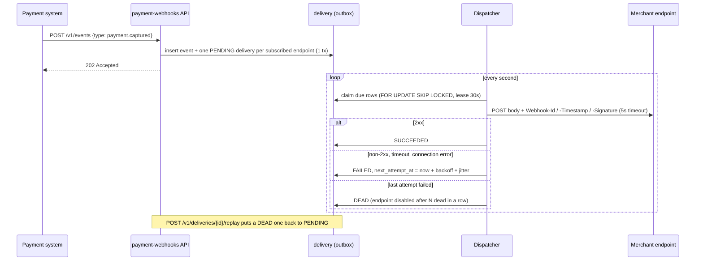

# payment-webhooks

[](https://github.com/HelenArams/payment-webhooks/actions/workflows/ci.yml)
[](LICENSE)

Webhooks are the part of payment APIs everyone gets wrong at first, me included. The happy path
is one `POST` and it works on day one. Then a merchant's endpoint is down for forty minutes during
a deploy, or answers 200 after 30 seconds, or someone replays a captured request, and you find out
which of the boring details you skipped.

This is a small Spring Boot service where I wrote those details down properly:

- **at-least-once delivery** – events go into an outbox table in the same transaction that
  accepts them; a poller sends them and keeps retrying with backoff until the receiver says 2xx
  or we give up
- **signed** – HMAC-SHA256 over `timestamp.body` with a per-endpoint secret, so a receiver can
  tell the request is ours and not a replay from last week
- **idempotent for receivers** – `Webhook-Id` is the event id and stays the same on every retry,
  and the body is byte-identical, so dedup on the receiving side is a unique index
- **dead letters you can do something about** – after the last attempt a delivery is `DEAD`, you
  can see why, and replay it once the receiver is fixed; an endpoint that keeps killing
  deliveries gets switched off instead of eating retry capacity

It's a portfolio project, not production-ready: single instance in practice (claiming is
multi-instance safe on Postgres, but I haven't run it that way for real), no auth on the API, no
tenant model. The interesting parts are the delivery semantics, not the CRUD.

## How a delivery moves



The HTTP call never runs inside a DB transaction. Claiming is one short transaction (lock, bump
`attempts`, set `leased_until`), then the send happens with no locks held, then the outcome is
written in its own transaction. If the process dies mid-send the lease just expires and the row
is picked up again, which is exactly the at-least-once part.

## Running it

Java 17 and Maven, nothing else (H2 in memory by default):

```bash
make run            # or: mvn spring-boot:run
```

With Postgres:

```bash
make up             # docker compose: postgres:17-alpine + the app on :8080
make down
```

Swagger UI is on <http://localhost:8080/swagger-ui.html>, metrics on `/actuator/prometheus`.

## Trying it with curl

Register an endpoint. The secret is in this response and **nowhere else**, so keep it:

```bash
curl -s localhost:8080/v1/endpoints -H 'content-type: application/json' -d '{
  "url": "https://webhook.site/your-id",
  "eventTypes": ["payment.captured", "payment.refunded"]
}'
```

```json
{
  "id": "6f1c0b3e-...",
  "url": "https://webhook.site/your-id",
  "eventTypes": ["payment.captured", "payment.refunded"],
  "enabled": true,
  "createdAt": "2025-10-10T19:02:11.418Z",
  "secret": "whsec_Qm9n..."
}
```

Emit an event (this is what the payment system would call):

```bash
curl -s localhost:8080/v1/events -H 'content-type: application/json' -d '{
  "type": "payment.captured",
  "payload": {"paymentId": "pay_42", "amount": 1999, "currency": "EUR"}
}'
# {"eventId":"a0f1e2d3-...","type":"payment.captured","occurredAt":"...","deliveries":1}
```

See what happened:

```bash
curl -s 'localhost:8080/v1/deliveries?status=FAILED'
curl -s 'localhost:8080/v1/deliveries?status=DEAD&endpointId=6f1c0b3e-...'
```

Replay a dead one, and switch an auto-disabled endpoint back on:

```bash
curl -s -X POST localhost:8080/v1/deliveries/<delivery-id>/replay
curl -s -X POST localhost:8080/v1/endpoints/<endpoint-id>/enable
```

Errors come back as `application/problem+json` (replaying something that isn't `DEAD` is a 409).

## What the receiver gets

```http
POST /your/hook HTTP/1.1
Content-Type: application/json
Webhook-Id: a0f1e2d3-1111-2222-3333-444455556666
Webhook-Timestamp: 1760123456
Webhook-Signature: v1=bfc4c0edadd967d7a27b50e034d15266d3b80bc96037a5144fc6b218a0c3ed0a

{"id":"a0f1e2d3-...","type":"payment.captured","occurredAt":"2025-10-10T19:10:56Z","data":{"paymentId":"pay_42","amount":1999,"currency":"EUR"}}
```

To verify: compute `HMAC-SHA256(secret, timestamp + "." + rawBody)`, hex-encode, compare with
the part after `v1=` in constant time, and reject timestamps more than ~5 minutes off. Use the
**raw** body bytes – if your framework parses and re-serialises the JSON first, the signature
won't match.

Java:

```java
boolean verify(String secret, String timestamp, String rawBody, String signatureHeader) throws Exception {
    long ts = Long.parseLong(timestamp);
    if (Math.abs(Instant.now().getEpochSecond() - ts) > 300) return false;

    Mac mac = Mac.getInstance("HmacSHA256");
    mac.init(new SecretKeySpec(secret.getBytes(UTF_8), "HmacSHA256"));
    String expected = "v1=" + HexFormat.of().formatHex(mac.doFinal((timestamp + "." + rawBody).getBytes(UTF_8)));

    return MessageDigest.isEqual(expected.getBytes(UTF_8), signatureHeader.getBytes(UTF_8));
}
```

Node:

```js
const crypto = require("crypto");

function verify(secret, timestamp, rawBody, signatureHeader) {
  if (Math.abs(Date.now() / 1000 - Number(timestamp)) > 300) return false;
  const expected = "v1=" + crypto.createHmac("sha256", secret)
    .update(`${timestamp}.${rawBody}`)
    .digest("hex");
  const a = Buffer.from(expected), b = Buffer.from(signatureHeader || "");
  return a.length === b.length && crypto.timingSafeEqual(a, b);
}
```

Then dedupe on `Webhook-Id` and return 2xx fast; do the actual work async. Anything that isn't
2xx within 5 seconds counts as a failure, and redirects are not followed.

## Retry schedule

Defaults, all in `application.yml` under `webhooks.retry`. Each delay gets ±20% jitter so a
receiver coming back from an outage doesn't get every queued webhook in the same second.

| attempt | delay before it | roughly this long after the event |
|--------:|----------------:|----------------------------------:|
| 1 | – | immediately |
| 2 | 10s | 10s |
| 3 | 30s | 40s |
| 4 | 2m | 2m 40s |
| 5 | 10m | 12m 40s |
| 6 | 30m | 42m 40s |
| 7 | 1h | 1h 43m |
| 8 | 2h | 3h 43m |
| 9 | 4h | 7h 43m |

After attempt 9 fails the delivery is `DEAD`. Five dead deliveries in a row for one endpoint
(`webhooks.endpoints.disable-after-dead`) disables it; any success resets the count.

## Code layout

```
src/main/java/com/helenaramyan/webhooks/
  endpoint/    registration, secrets, auto-disable counters
  event/       POST /v1/events and the fan-out into deliveries
  delivery/    outbox entity, claimer, sender, retry schedule, outcome handling, metrics
  signature/   HMAC signing + reference verification
  api/         problem-details error mapping
  config/      properties, RestClient, executor, OpenAPI
src/main/resources/db/migration/   Flyway, works on H2 and Postgres
```

## Tests

```bash
make test           # mvn verify: unit + integration tests, jacoco report in target/site/jacoco
```

The ones I care about:

- `WebhookSignerTest` – a known HMAC vector (computed separately with Python), plus tampering,
  wrong secret, stale timestamp
- `RetryScheduleTest` – the schedule against a fixed clock, jitter bounds, dead after max attempts
- `DeliveryDispatcherTest` – a real WireMock receiver: 2xx, 500 then 2xx (same `Webhook-Id` and
  body, new signature), slow receiver hitting the timeout, redirect not followed, connection refused
- `DeliveryReplayTest`, `EndpointAutoDisableTest` – dead → replay → delivered, and the endpoint
  circuit breaker

Time is a `Clock` bean everywhere, so tests move a mutable clock forward instead of sleeping.
The scheduler is off in tests and they call `dispatcher.runOnce()` directly. I also ran the whole
suite against Postgres 17 once by pointing `spring.datasource.*` at a container; CI only runs H2.

## Notes to self

- [ ] idempotency key on `POST /v1/events` – right now a producer retry fans out twice
- [ ] secret rotation: two valid secrets for an overlap window, send both as `v1=a,v1=b`
      (receivers then need to accept any match)
- [ ] testcontainers job in CI so Postgres-specific stuff (`SKIP LOCKED`) is covered every run

## License

MIT
